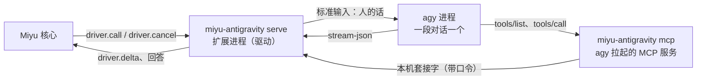

## antigravity：把 Antigravity CLI 当模型供应商

Miyu 的一个扩展包（包编号 `antigravity`，仓库和程序叫 `miyu-antigravity`）。它登记一个模型驱动 `antigravity/antigravity`：
主人在供应商配置里写上它，这家供应商的每一次调用就交给本机的 `agy`，用的是主人在 agy 里已有的登录和订阅额度。

状态：已定（2026-11-14，agy-cli 会话写；第十一节四条项目主人当天定了）。照核心设计 `66-扩展提供模型驱动.md`、
`71-供应商侧工具.md` 做。

### 一、定了的方向（项目主人 2026-11-14，记在核心设计 71 第一节）

- **agy 只当模型。** 工具循环在 Miyu：Miyu 的工具经本包自己的 MCP 服务挂给 agy，agy 一调，本包就把这次调用交回核心去
  执行，权限、沙盒、工具卡片和别的模型一样；结果再经 MCP 回给 agy。
- agy 跑命令、读写文件的原生工具全关。只读、不碰本机的原生工具留在 agy 里跑，报成供应商侧工具（设计 71）。
- 旧版 Miyu（0.7）的做法是把整个工具循环交给 agy，不照搬；它的代码只当「agy 这个 CLI 怎么用」的参考。

### 二、agy 是什么样的（1.4.0，2026-11-14 在隔离的家目录里实测；带「旧」的是旧版代码记下的、这次没重测）

| 事 | 实测 |
|---|---|
| 怎么调 | `agy --print= --input-format stream-json --output-format stream-json --dangerously-skip-permissions --model <slug> --agent <名> --add-dir <目录> --print-timeout <N>s [--conversation <id>]`；提示词从标准输入给，一行一轮：`{"event":"user","message":{"content":[{"type":"text","text":"…"}]}}` |
| 输出 | 一行一个事件，三种：`init`（带 `conversation_id`、`init.agent`）、`step_update`、`result` |
| 正文 | `step_type: "agent_response"`，`text_delta` 是增量；一步先几条 `ACTIVE`、最后一条 `DONE`，`DONE` 带这一次模型调用的 `usage {input_tokens, output_tokens, thinking_tokens, cache_read_tokens}`（`input_tokens` 是没命中缓存的那部分） |
| 思考 | 流里没有思考的字，只有 `thinking_tokens` |
| 工具步骤 | `step_type: "tool"`，同一个 `step_index` 两条：`ACTIVE`（`tool_info.parameters` 一次给全）、`DONE` 或 `ERROR`。MCP 工具的 `DONE` 带 `tool_info.output`；**原生的 `search_web`、`read_url_content` 的 `DONE` 不带结果** |
| 原生工具的结果在哪 | agy 自己的转录 `~/.gemini/antigravity-cli/brain/<会话>/.system_generated/logs/transcript_full.jsonl`：同一个 `step_index` 的一行，`content` 是结果的字 |
| `search_web` | 参数 `{"query"}`；结果是一段带引用编号的搜索摘要 |
| `read_url_content` | 参数 `{"Url"}`；结果只有标题和一句「全文存在 `…/steps/<n>/content.md`，可以用 `view_file` 读」——**不开 `view_file` 它就读不到正文** |
| 系统提示词 | 没有参数能给。写成自定义代理 `~/.gemini/config/agents/<名>/agent.md`（frontmatter 的 `tools:` 是原生工具的白名单，正文整体替换 agy 的默认指令），`--agent <名>` 选它。白名单只写这两件时，让它列目录它答没有工具（实测）。`init.tools` 列的是整张注册表（60 件），不是开着的 |
| agy 自己加的字 | 人的话外面包 `<USER_REQUEST>`，后面跟当前时间等几段；一轮空对话约 2.7k token 的底 |
| MCP | 只能全局注册在 `~/.gemini/config/mcp_config.json`；agy 起来时就拉起 MCP 服务，**把自己的环境变量原样传给它**（实测）。条目里 `tools: {<名>: {"eager": true}}` 的，在 agy 那边叫 `mcp_<服务名>_<工具名>`，可以直接调 |
| MCP 调用的先后 | 模型一步里要了两个调用，agy **一个做完再发下一个**（实测）：同一时刻至多一个调用挂着 |
| MCP 等多久 | 条目里不写超时的，一个调用等 **3 分钟**就判失败（`MCP tool call to server "…" timed out after 3m0s`，模型自己接着说）；写了 `"timeoutSeconds": 3600` 的，实测挂 25 分钟照样等到结果。等的时候流里一条都不出 |
| 续传 | `--conversation <id>`；目标没了**不报错、悄悄新开**，只能核对 `init` 里的编号（旧） |
| 进程复用 | 标准输入不关，再写一行就是下一轮，复用时不再发 `init`；冷启动 5～9 秒（旧） |
| 输入上限 | 只收文字；一条超过 192,000 字节的从尾部悄悄截断、照样报成功（旧） |
| 坏会话 | 出过错的会话带着错误状态，之后每轮原样回吐（旧）；被 Google 内容策略拦下的，拦截文案当正文流出来、`result` 报成功（旧） |
| 模型 | `agy models`：一行 `slug<TAB>显示名`，档位在 slug 里（`gemini-3.8-flash-low`、`claude-opus-5-5-high` 这样） |
| 登录 | `~/.gemini/antigravity-cli/antigravity-oauth-token`；`HOME` 换成别的目录、里面放这份文件就能用（多账号就是这么分的） |

**2026-11-16 真机补测（AG-3 做完后，隔离的家目录，flash 档）：**

- 代理文件 `tools: []` 时 MCP 的 `eager` 工具照样能调：白名单只管 agy 的原生工具，**管不到 MCP 工具**。
- 流里 MCP 工具步的名字是 `mcp_miyu_<工具名>`；`tools/call` 和流里的 `ACTIVE` 前后脚到（实测 MCP 那边先到）。
- 一件、连着两件工具调用、带结果以后接着说、下一轮复用同一个进程、人打断工具后重放，都走通；等工具结果时流是静的。
- 扩展退出时 agy 和它拉起的 MCP 服务一起没了，会话文件、套接字文件都删了。关标准输入以后 agy 会再写一条
  `result`（`ERROR`，`stream input cancelled`），没人听，只进日志。
- agy 自己每次请求约带 3,400 token 的固定开销（一句话的提问 `input_tokens` 是 3,453）。

**2026-11-16 真核心验收（核心 main `85fb27c67`，独立数据根，装包 → 对话 → 卸载）：**

- 装包、批能力、`miyu check` 过；读文件、接着搜索（复用同一个 agy 进程）、写文件再跑命令都走通，核心日志没有告警；
  搜索在会话日志里是一块 `hosted_tool`（名字、参数、结果）。`miyu antigravity unregister`、`miyu pkg remove antigravity` 照 README 走通。
- 清单里文字项的默认值不能是空的（`antigravity.binary` 原来写了 `default = ""`，真核心拒收）：不写默认值。
- agy 把它自己的临时工作目录当「工作区」报给模型，模型照它写过文件链接：代理文件正文在系统提示词后面接一段说明
  （`words::AGENT_NOTE`），之后模型报的是对的路径。
- 最慢的档位（xhigh）一道难题从发出到第一个字 97 秒（思考约 2.2 万 token）：核心默认 180 秒的空闲时限够、余量不大，
  README 让主人在高档位的模型条目里写 `effort`。
- 扩展被硬杀：agy 和 MCP 服务自己退（闲着的 1 秒内、挂着工具的 6 秒内），套接字文件、工作目录、会话文件留下，
  下一次启动时清扫（`leftovers.rs`）。

### 三、形状

- **扩展进程**（核心拉起）：接 `driver.call`，管着 agy 进程、对话的对应、给 MCP 服务用的本机套接字。
- **MCP 服务**（agy 拉起，同一个程序的 `mcp` 子命令）：很薄，只把 `tools/list`、`tools/call` 转给扩展进程。它靠 agy 传下来的
  环境变量（套接字地址、一次性的口令）认出自己属于哪个 agy 进程。没有这两个变量的（主人自己开的 agy）回一张空的工具表。
- **agy 进程**：一段对话一个，活着的时候连着收好几轮。

### 四、一次 `driver.call` 怎么走

1. **认是哪段对话。** `driver.call` 里没有会话编号。扩展自己记着每个活着的 agy 进程「上一次请求每条消息的指纹」（`fingerprint.messages`）
   和那一次系统提示词、工具面、模型的指纹。这一次的消息指纹以它为前缀、别的指纹都一样的，就是那段对话的下一步。
2. **是哪种下一步**，看前缀后面多出来的消息：
   - 一条 assistant（我们上一次交的）加一条或几条 user：新的一轮。把 user 的字写进 agy 的标准输入。
   - 一条 assistant（里面是我们交的工具调用）加它的 tool 结果，而且那个 agy 进程正挂着这一个 MCP 调用：把结果经 MCP 回给 agy，
     接着读流。
   - 别的（对不上、多了少了、挂着的调用对不上号）：这段 agy 对话作废（杀进程），照第五节重放。工具结果后面核心还接了
     别的消息的（人在她干活时排进来的话、切了权限的告知）也算这一种：这一版不往挂着的调用里塞话，重放一次。
   - 挂着的那段，认的时候比闲着的多看三样，哪一样不对都作废、重放：assistant 那条里恰好一个工具调用、它的私有数据
     是我们交的那个编号；tool 那条的 `call_id` 就是这个工具调用的；挂着期间 agy 的流里没来过任何一行（来了说明它那边
     已经不等了，见第十节）。
   - 一次请求的消息以某段**挂着的**对话记着的那串开头（含一模一样）、却不是上面那种接法的（人打断了工具又说了话、
     核心把同一次请求重发了一遍）：那段挂着的当场收掉，不等它到点。
3. **没有对得上的**：新开一段 agy 对话，把整份历史转写成一条文字发过去（第五节）。
4. **读流，交增量**（核心设计 66 第五节的写法）：
   - `agent_response` 的 `text_delta` → 一块正文。
   - 原生工具步骤（`search_web`）→ 一块供应商侧工具：`ACTIVE` 开块、交参数；`DONE` 以后从转录里读结果交 `outcome`、收块。
   - MCP 工具步骤：内容以 MCP 服务收到的 `tools/call` 为准（名字、`arguments` 原文），先后以流为准：等流里这件工具的
     `ACTIVE` 步也到了再交（它前面的正文都已经读完），交一块工具调用（私有数据里记这一次 MCP 调用的编号）、收块，
     **这一次 `driver.call` 到此结束**（回用量）。agy 那一头挂着等。两边只到了一边的：等 10 秒，流那边没到照交，MCP 那边
     没到（MCP 服务没连上扩展）这段对话作废、这一次出错。
   - `result`：这一轮说完了，回用量；`status` 不是成功的照第八节归类。
5. **用量**：这一次 `driver.call` 期间每个 `agent_response DONE` 的 `usage` 加起来（记账）；另报 `context`：最后一个结束时的上下文大小（输入、命中缓存的加输出），核心判满照它（AG-13，核心 ACP-1；AG-12 时曾只报最后一次的输入，记账偏少）：`uncached = input_tokens`、
   `cache_read = cache_read_tokens`、`output = output_tokens`、`reasoning = thinking_tokens`。`result.usage` 是整段会话累计的，不用。

模型一步里要了几个工具调用时，agy 一个一个发：Miyu 这边看到的是连着几条回复、每条一个工具调用。

### 五、新开对话时的重放

- 触发：没有对得上的 agy 对话（第一次、核心重启、扩展重启、压缩、撤销、分叉、换过模型又换回来、上一段作废了）。
- 做法（照旧版 `cli_relay/payload.rs` 的格式）：一段说明加 `<conversation-history>`，里面照先后写 `User:`、`Assistant:`、
  `[called tool NAME with ARGS]`、`[tool result]`；最后一轮的 user 消息单独成块跟在后面。供应商侧工具照核心给的那段
  `<hosted-tool>` 的字。
- 一条输入不超过 172,800 字节（agy 的上限打九折）：超了从最老的回合丢起，写一句省略；这一轮的消息不砍。
- 请求的最后一条是 tool 结果、却没有挂着的调用（例如核心重启以后接着跑工具循环）：历史照样转写，末尾补一句让它接着做。

### 六、工具面

- 每个 agy 进程的工具表是它那段对话的 `request.tools`：名字、说明、参数格式。MCP 服务答 `tools/list` 时照 Gemini 认的写法
  整形（只留它认的键、`type` 不许是数组、空的 `enum`、空 `properties` 的对象要改写；一件写坏了会让整轮的工具全被拒）。
- agy 照参数格式校验模型给的参数，没声明的属性整次调用拒掉。它自己的工具每件都带 `toolAction`，模型照这个习惯也往 Miyu 的
  工具里填（2026-11-23 主人的群聊会话从某一次起每次都这样被拒、一直答不出来）。所以每件工具都多声明一个可选的 `toolAction`，
  `tools/call` 转给 Miyu 之前去掉（AG-11）。
- 直接调要逐个登记：扩展把见过的工具名并进 `mcp_config.json` 里本包那一条的 `tools`（`eager`）。名单变了要等下一个新起的
  agy 进程才生效；工具面和记着的不一样的，那段对话照第四节第 1 条本来就对不上，会新开。
- 全局注册的条目叫 `miyu`（agy 那边的工具名是 `mcp_miyu_<名>`）；旧版 Miyu 留下的同名条目由本包接管、改写。
- 核心交回的工具结果是几块：文字接起来回给 agy；图片、文件这一版换成一句占位（MCP 能带图，agy 收不收以后再测）。

### 七、供应商侧工具

- 这一版只开 `search_web`：清单 `hosted = ["search_web"]`，代理文件的白名单也只写它。结果从转录读，去掉开头两行时间。
- `read_url_content` 不开（第十一节第 1 条）：它只交回标题和一个本机文件路径，要 `view_file` 才读得到正文，而 `view_file` 是能读
  本机任意文件的原生工具，必须关着。读网页走 Miyu 自己的 `web_fetch`（经 MCP，核心执行）。
  2026-11-16 主人问过要不要也放开，真机（agy 1.4.0、flash-low、临时把它加进白名单）重测，照旧不开：
  - **它不是厂商那边的抓取服务**：让它读本机回环上的一个网页，那个网页收到了请求，`User-Agent` 是 `Go-http-client/1.1`
    ——是 agy 这个程序自己在本机发的普通 GET，不跑页面脚本；也就是说它够得到本机和内网的地址，又不过 Miyu 的权限和确认。
  - **正文一半没转成文字**：四个网页里两个（`spec.editorconfig.org`、本机那个）存的是转好的文字，两个（维基百科一个词条
    144 KB、Rust 书的一章 56 KB）标题成了 `Live Content`、存的是整份 HTML 原文。
  - 没有 `view_file` 时模型会自己改用 Miyu 的读文件工具去读那份 `content.md`（四次都是），所以技术上接得通；但每个网页多一次
    工具往返，读到的还可能是 HTML 原文，不比 Miyu 自己的 `web_fetch` 强。
- agy 自己记着对话，驱动不用把这种块带回去；交的时候不带私有数据（核心设计 71 第三节第 5 条）。
- **别的工具步一律照实交成供应商侧工具**（名字原样）：流里出现的工具步，不是 `mcp_miyu_` 开头的，都是 agy 那边自己跑了的
  ——`search_web`，也可能是主人在 agy 里自己配的别的 MCP 服务、插件带的工具（`mcp_config.json` 是全局的，白名单管不到，
  本包关不掉）。它们不过 Miyu 的权限和确认，本包做得到的是不瞒着：照实显示，没写进清单 `hosted` 的核心会记一行警告。
  不想让模型在 Miyu 里用到的，主人在 agy 那边关（`agy mcp disable <名>`）。README 写明。
- 结果从哪来：这一步 `DONE` 时流里带了 `output` 的用它，没带的从转录读（`search_web`）；读不到的不交结果、照样收块。
  `ERROR` 的交 `failed`，字是流里的原话。自己先截到 64 KiB。

### 八、出错、打断、清理

| 情况 | 怎么认 | 归成 |
|---|---|---|
| 上下文超长 | `exceeds the maximum number of tokens allowed`、`input token limit`、`which is more than the max tokens limit`（排在「请求本身有错」前面，第十六节） | `context_too_long`，核心先压缩再来 |
| 请求本身有错 | `invalid_argument`、`failed_precondition`、`not_found`、`(code 400)`、`(code 404)`（排在最前，第十六节） | `unclassified`，核心不重试 |
| 没登录、账号用不了 | `result.error` 里有 `not logged in`、`unauthenticated`、`terms of service`、`permission_denied`、`(code 403)` 这类字（标准错误里那行每次都有，不算数） | `auth` |
| 额度、限流 | `quota`、`rate limit`、`resource_exhausted`、`usage limit`、`credits` 这类字 | `quota` / `rate_limited`；这段对话作废 |
| 内容策略拦截 | 正文就是那段固定的拦截文案 | `content_policy`；不交那段字；这段对话作废 |
| 续传丢了 | `init` 的编号不是要的那个 | 当场杀掉，照第五节重放一次 |
| 代理没挂上 | `init.agent` 不是要的那个 | `unclassified`，原话写明 |
| 别的出错、没有 `result` 就退出了 | — | 还没交增量的 `retryable`，交过的 `unclassified`；这段对话作废 |

- `driver.cancel`、核心不要了：对 agy 的进程组先 `SIGTERM`、5 秒后 `SIGKILL`，这段对话作废。
- 挂着的 MCP 调用等不来结果（人打断了、换了供应商）：超过第十节的上限就收掉那个进程。表里超过上限时，挂着的和闲着的
  一样照「最久没用的先挤」收。
- 清理：作废的、闲置到点的 agy 进程收掉；它在 agy 那边的会话文件（`conversations/<id>.db*`、`brain/<id>/`）一起删；代理目录
  一小时没用过的删。扩展退出时把自己起的 agy 全收掉。

### 九、系统提示词、模型、配置

- 代理文件名 `miyu-<内容哈希>`，正文是 `request.system`，每次起 agy 前写好；起来以后核对 `init.agent`。
- `driver.models` 照 `agy models` 的输出交；窗口、最大输出 agy 不报，留给主人手写或目录。`params.effort` 不用：档位在模型名里。
- 清单：`cache = "best_effort"`、`key = "none"`、`base_url = "none"`（0.1.3 起，第十七节）、`images = true`、`files = true`（0.1.4 起，第十八节）。
- 配置项：`antigravity.binary`（agy 在哪，默认找 `PATH`）、`antigravity.keep_seconds`（agy 进程闲置多久收，默认 600）、
  `antigravity.tool_wait_seconds`（第十节）。用哪个账号不归本包管：agy 用它自己的登录，扩展照自己的 `HOME` 跑它。
- 供应商和模型条目主人手写（扩展改不了配置）：`driver = "antigravity/antigravity"`，价格写 0。README 给能抄的例子。

### 十、时限

- **agy 等 MCP 调用**：本包那一条 MCP 写 `timeoutSeconds`，值是配置项 `antigravity.tool_wait_seconds`（默认 3600）加 60。
  核心执行工具、等人点确认的时间都算在里面。扩展自己也照这个数等：到点还没等来带结果的下一次 `driver.call`，就收掉那个
  agy 进程，这段对话作废。agy 先判了超时的（流里那一步是 `ERROR`、原话带 `timed out after`），同样作废：它那边已经当
  工具失败接着说了，和 Miyu 这边对不上。认法不看原话：agy 等 MCP 调用时流是静的，**挂着期间流里来了任何一行**就算它
  不等了（MCP 服务那条连接这时还开着，光靠回话写不写得进去认不出来）。
- **核心等增量**：一次 `driver.call` 里 180 秒没有一条增量就判超时（思考强度高的放大），总共不超过它的 10 倍。agy 不流
  思考的字：从写进标准输入到第一段字，实测几秒到十几秒（flash 档）；慢的档位、搜索慢的时候会不会超，AG-5 拿真 agy 量。
  超了的话这一版先照核心的规矩当可重试，量出来真碰得到再找核心商量保活的写法。
- **整轮**：`--print-timeout` 给一天，活不活靠上面两条判。

### 十一、项目主人定了的（2026-11-14）

1. `read_url_content` 不开，只留 `search_web`（第七节）。
2. 往主人真的 agy 配置里写两样：`~/.gemini/config/agents/miyu-*/`（系统提示词）和 `mcp_config.json` 里的 `miyu` 一条。主人
   自己开 agy 时这条 MCP 给的是空的工具表。
3. 仓库公开，先当社区包收进软件源。2026-11-16 改定：放个人账号下，`SHORiN-KiWATA/miyu-antigravity`（第三方包，照社区包收录，
   不进软件源的 official.toml）；原来建在 `miyu-agent/` 下，当天转过去的。
4. 多账号不是本包的事：不做选账号、不做轮换，就照 agy 命令行现成的用法调它。

### 十二、不做的

- 图片进 agy、思考的字、agy 的原生工具（除了 `search_web`）、agy 自己的子代理和后台任务。
- 多账号：选账号、几个账号轮着用、额度用完自动换（第十一节第 4 条）。
- Windows：第一版只打 Linux、macOS 的包（进程组、本机套接字的写法先照 Unix）。

### 十三、施工

| 步 | 做什么 |
|---|---|
| AG-1 | 骨架：仓库、清单、握手、`driver.models`；agy 的流解析（照实测录下的样本）；一问一答的 `driver.call`（没有工具、每次新开对话重放） |
| AG-2 | 对话的对应和进程复用：指纹前缀、续上、作废、清理 |
| AG-3 | MCP 服务和工具交回：套接字、`tools/list` 整形、`tools/call` 挂起、结果回给 agy；全局注册 |
| AG-4 | `search_web` 报成供应商侧工具（读转录）；出错归类；内容策略、坏会话 |
| AG-5 | 真 agy 走一遍的验收脚本、README、发版流程 |

### 决定

| 已定 | 没选 | 重开条件 |
|---|---|---|
| agy 只当模型，工具交回核心 | 工具循环交给 agy（旧版） | 无 |
| 对话靠消息指纹的前缀认 | 等核心在 `driver.call` 里给会话编号 | 核心给了会话编号 |
| MCP 服务是 agy 拉起的薄壳，经本机套接字找扩展 | 扩展自己开 HTTP 的 MCP 服务（全局只能登记一个地址，认不出是哪个 agy） | agy 能按进程指定 MCP 配置 |

### 十三、界面实测（2026-11-16，0.1.0 发版以后）

照「交之前当用户真用一遍」的规矩补的：独立数据根的核心（main `85fb27c67`）、只放了登录令牌的隔离家目录、真 agy 1.4.0、
`gemini-3.8-flash-low`、预设「全部功能」；终端界面和网页界面是本机装着的 2026.11.0-rc.2.2，用 niri 的 agent seat 操作、截图。

- **抓到一个 0.1.0 的毛病**：agy 头一次运行会自己建一份 **0 字节**的 `~/.gemini/config/mcp_config.json`。0.1.0 把它当成
  「读不懂的文件」不肯写，没在 agy 里配过 MCP 的人头一句话就报错。0.1.1 起空文件（只有空白的也算）当成还没有服务。
  之前的真机验收没撞上，是因为那几个隔离家目录里这份文件要么还没有、要么是我做试验时写过的。
- **价格**：不写 `local = true` 时核心照模型目录给 `gemini-3.8-flash-low` 算钱（三轮累计显示 ¥0.127）；写上以后再聊一轮金额
  不动。README 原来写的「Miyu 这边按 0 记」不对，已改成要写 `local = true`。
- **终端界面**：首次配置的「模型」一步认出了配置里的模型；读文件一轮（工具调用显示成「读取 · notes.txt」，12.0 秒）、
  联网搜索一轮（过程中显示一行 `search_web`，收起后是 `Used 1 tool`，11.8 秒，答对）、不用工具的两轮（3.4 秒）都正常。
- **网页界面**：设置的「软件包」里有这个包（图标、运行中、三项设置的名字和说明、默认值、上游链接）都对。
- 扩展被杀掉以后核心一秒后重新拉起，开头的清扫把上一个进程留下的套接字删了（日志里有一行 `cleaning up`）。
- 没做的：安装确认屏里「供应商侧工具」那一行（要更新的核心才画，core1 在看）；网页界面里聊天；高档位模型。

### 十四、0.1.2（2026-11-17，主人本机验收以后）

主人在本机装 0.1.1 验收，这一条没过：装上以后不知道怎么切到这家供应商；程序路径填的是 `~/.local/agy-multi`（他自己按账号
分流的包装脚本，实际在 `~/.local/bin/` 下）。查到的和改的：

1. **装上以后没有供应商**：包自己写不了 `providers.*`（核心设计 66），0.1.1 的 README 让人手写配置。现状不改文件的走法是
   `miyu config set providers.<编号>.driver antigravity/antigravity` 一句（实测：之后 `/model` 列出 `agy models` 的 17 个模型），
   或终端界面 `/config` →「供应商和模型」→ `a` →「自定义…」里把接口切到 `antigravity/antigravity`（实测建得出）。我提过加一条
   `miyu antigravity setup` 替人跑这句，**主人否了**：要的是「装上这个包，供应商列表里就出现这一家，直接切」，由核心做
   （核心 PV-4：清单里声明自带的供应商）。2026-11-18 写法定了，本包照写：`[providers.antigravity]`，只有 `name` 和
   `driver`，模型列表照 `driver.models` 拉；编号用包名（核心文档建议挑不容易撞的），模型写成 `antigravity/<模型>`。
   README 改成「装上就有」。同一批的 PL-2：`[package] systems = ["linux", "macos"]`（不做 Windows）。
   **代价**：带 `[providers]` 的清单，不认它的旧核心直接拒装（本机装着的 2026.11.0-rc.2.3 实测：
   `不认识的表 [providers]`），所以这一版要含 PV-4 的核心。
2. **三项设置的名字**照主人定的改：可执行文件路径、对话结束后进程保留时长（秒）、工具调用超时时长（秒）。第二项的含义没变：
   一轮说完以后 agy 进程留着等同一段对话下一轮多久。
3. **程序路径认开头的 `~`**（`config::expand_home`）：只认头一段正好是 `~` 的。
4. **金额**：核心照模型目录的 API 价给这家的模型算金额，主人定「照 API 价算没有问题」。README 从「要写 `local = true`」改成
   「想按 0 记的再写」。
5. **一个竞态**（`teardown::an_idle_agy_that_exited_is_noticed_on_the_next_turn` 40 次里红 1 次）：闲着的 agy 在「看过它还
   活着」和「这一轮接上路由」之间退了，读输出的线程把最后一条信号送给了没人听的路由，这一轮一直等不来信号。`talk` 接上路由
   以后再看一眼 `closed`，自己补一条。改完那条测试连跑 200 次没红。
6. **包装脚本给 agy 换了 `HOME`**（主人的脚本对副号就是这样，假家目录的 `.gemini/config` 软链回真的）：仿了一个这样的脚本
   真机实测，0.1.1 下对话能跑，但 agy 的对话数据落在假家目录——搜索结果的字读不到（日志 `agy's transcript has no result`）、
   会话文件删不到。改法：agy 拉起的工具服务（继承 agy 的环境）每次找扩展时把自己的 `HOME` 报上来（套接字请求多一格可选的
   `home`），总台记在这段对话的口令上，读转录、删会话文件、启动清扫的记号（第二行）都照它（`src/agy_home.rs`）。不带工具的
   调用（核心给会话起标题那种）也接上总台、给那两个环境变量：全局 `mcp_config.json` 里已经有 `miyu` 一条时，agy 照样会拉
   工具服务来问一次空的工具表，顺带报到家目录。只有「从没登记过 `miyu`、头一次调用又不带工具」的那一次报不到，照扩展自己的
   `HOME`。没用主人真的脚本和账号测过。
   补完以后同一套仿的脚本真机复验：带工具的对话和起标题的那段（不带工具）记号都有第二行，搜索结果读得到，核心正常停下
   以后两个家目录里这一轮的会话文件都没了。空工具表的口令上来了工具调用的（agy 调了全局文件里别的对话登记的名字），总台直接
   回出错的结果，不交回核心。
7. 这一轮实测是在本机装着的核心（pacman 的 2026.11.0-rc.2.3）加独立数据根、只放登录令牌的隔离家目录里做的，终端界面用
   niri 的 agent seat 操作；看到的：0 字节 `mcp_config.json` 在场时头一句带工具的话照常（0.1.1 的修复）、搜索的时间线是
   「网络搜索（<供应商名>） · <搜的词>」。
8. 实测时模型那边忽快忽慢（同一步有时 6 秒、有时 23 秒，经不经包装脚本都一样）：agy 自己的日志里没有限流、重试的行，每次
   `streamGenerateContent` 之间就是隔这么久，不是本包加的。
9. **自带供应商的实装**（2026-11-18，核心 `58de4f64b` 在另一台机器上编的，独立数据根、隔离家目录、真 agy，终端界面是本机装着的
   rc2.3）：本地的 0.1.2 装上以后 `config.toml` 一个字没写，`miyu config explain providers.antigravity.driver` 说是「软件包
   antigravity」那一层给的；首次引导的「模型」一步认出了配好的模型；`/model` 列出 `antigravity` 这家的 17 个模型，选下一个
   （`gemini-3.8-flash-medium`）就切过去了；读文件、联网搜索（时间线「网络搜索（Antigravity） · 搜的词」）、抓网页都走了；
   卸掉包以后这一家没了（`miyu check` 报默认模型指的供应商没有配，是该报的）。
   这一轮里 medium 档每次模型调用要 100～150 秒才有第一个字（agy 的日志里请求发出去以后就是等，没有重试），离核心 180 秒
   的静默时限很近：agy 不流思考的字，档位高的、工具多的时候主人多半要给模型写 `effort`。包自带的供应商没法按模型名的后缀
   自动带上这一格（`driver.models` 交不了 `effort`），这件事交给核心那边看要不要给驱动一个说法。
10. **最低核心版本**：清单写 `miyu = "2026.11.0-rc.2.4"`（含 PV-4、PL-2 的头一个版本，core1 给的）。核心读清单时本该先看这一格、
    版本不够就报「要更新的 Miyu」，但本机的 2026.11.0-rc.2.3 实测装目录包仍然先撞「不认识的表 [providers]」（中、英文界面都是）：
    core1 查到是装目录包那条路的版本比较拿了编译时的版本号，记成核心 VER-1；旧的 rc.2.3 修不了。从软件源装的那条路没测到。
    VER-1 在核心 `709c88265`（CB-3）里修了：版本照 semver 比、候选版也比，rc.2.3 以后的核心装要 rc.2.4 的包会说「先更新 Miyu」。
11. **空闲时限放宽到 300 秒**（2026-11-18，核心 DR-2，同在 CB-3 里）：`[[driver]]` 写 `quiet_secs = 300`。第 9 条实测 medium 档每次
    模型调用要 100～150 秒才有第一个字，离核心默认的 180 秒只差一点；agy 不流思考的字，这段时间流是静的，本包没有可以
    保活的东西。`quiet_secs` 只放宽不收紧，等第一个字、两段之间都照它等，写了 `effort` 的高档位照思考强度再放大。取 300 是
    给实测最慢的 150 秒留一倍余量；真卡死的要多等两分钟才被发现，这个代价可以接受。这个键要含 DR-2 的核心才认，
    最低核心版本仍写 `2026.11.0-rc.2.4`（rc.2.4 从含 CB-3 的 main 上出）。还没在真核心上装过，发版前和 rc.2.4 一起验。

### 十五、审计 #160–#163 的核实（2026-11-18）

别家 AI 的全项目审计报告里本包四条，逐条二次核实（真 agy 1.4.0，隔离家目录）：

- **#160 一步里几件工具调用会丢、会触发重放：不成立。** 让 `gemini-3.8-flash-low`、`claude-sonnet-4-6`、`gemini-4-hydrogen-low`
  各「一步同时读三个文件」：模型一步里确实发了三件，但 agy 排着队执行——上一件的 MCP 结果回来才发下一件，本包一件一件接住
  （第 2、3 次 `driver.call` 立刻回来、不带用量，是同一步里的），没有被拒的第二件、没有 `stray`、没有重放。代码里第二件在
  第一件还等着时到了，是拒掉（`talk.rs`），不是报告说的覆写。
- **#161 预算算在 JSON 转义之前会超 agy 的上限：主体不成立。** agy 的 192,000 字节上限算在解出来的字上：字 185 KB 的首尾都
  看得到；字 200 KB 的尾部没了；字 120 KB、170 KB 而全是引号换行（写进标准输入的那一行 210 KB、297 KB）的首尾都看得到。
  附带属实的一点：这一轮的消息不砍（第五节的取舍），单条超过上限的会被 agy 截尾——加了一行日志（`agy::warn_long`），行为不变。
- **#162 握手没报 `locale`、没验协议版本：不成立。** `locale` 是可选格，本包给人看的字只有英文；协议范围报的是 `[1, 1]`，
  核心选不出就回 `protocol_mismatch`，本包对出错的握手已经退出码 1。
- **#163 工具名单只增不减、卸包后留悬空的条目：一半成立。** 名单只增是有意的（替换的话，两次登记抢在 agy 读配置之前时先登记
  的那段对话的工具不是 eager），量有界。卸包后 `mcpServers.miyu.command` 指着已经删掉的程序属实（核心没有卸载钩子）。
  改法：扩展正常退出（核心关标准输入：停核心、关包、卸包）时，这个进程登记过、而且那一条的 `command` 还指着本程序的，把它
  拿掉（`mcp_config::unregister_own`）；指着别的程序的（另一处装的 Miyu 登记的）不动。名单也就每次退出清零。被硬杀的来不及
  收，照旧靠 `miyu antigravity unregister`。代价：核心重启以后、头一次带工具的调用之前，不带工具的调用报不到 agy 的家目录
  （第十四节第 6 条），照扩展自己的 `HOME`。
- 实测时顺带看到 agy 的模型表换了（Claude 是 `claude-sonnet-4-6`、`claude-opus-4-6-thinking`，多了 `gemini-4-carbon-*`）：
  本包的列表每次现取，不受影响。

### 十六、AG-7：再来也一样的错不重试（2026-11-20）

主人在本机用 0.1.2（核心 rc2.4）撞上两件，都被核心重试到第 5 次：

- 账号被停用：agy 报「This service has been disabled in this account for violation of Terms of Service. Please submit an appeal
  to continue」，界面上是「重试 3/5」。
- Gemini 拒收工具参数格式：`INVALID_ARGUMENT (code 400): * GenerateContentRequest.tools[28]…properties[days]…`（im 包的
  `qq_activity_ranking` 在整数参数上写了 `enum`），界面上是「重试 1/5」。

**根因**：重试不是本包做的，是核心照回答里的 `error.class` 定的（核心参考文档「扩展」一页 `driver.call` 的「回应」；核心
`miyu-kernel` 的 `session/retry.rs`：`retryable`、`stalled`、`rate_limited` 这几类同一步最多再来 5 次，`auth`、`quota`、
`content_policy`、`unclassified` 不再来；经池调用的 `auth`、`quota` 还会冷却这个模型、换下一个）。本包的归类表（第八节）
认不出这两句，落到「别的」那一格，还没交过增量的报成 `retryable`。

**改法**（`src/failure.rs`）：

1. 加一组「请求本身有错」的字眼：`invalid_argument`、`failed_precondition`、`not_found`、`(code 400)`、`(code 404)`，报
   `unclassified`，不管交没交过增量。排在表的最前：请求有错的原话会点出出错的属性名、工具名，名字里带 `quota`、`sign in`
   的工具写坏了，不该被当成额度用完、没登录。
2. 认证那一组加上账号用不了的字眼：`terms of service`、`submit an appeal`、`permission_denied`、`(code 401)`、`(code 403)`，报 `auth`。
3. 原话照旧：回答的 `message` 是「agy failed (ERROR): 」加 agy 的原话，核心截到 500 字给人看。

依据：Gemini 的出错说明把 400（请求写错、前提不满足）、403（没有权限、账号受限）、404（模型不存在）列为要人改了才行的，
排查一页写明只对 429、408、5xx 这种一时的错重试，400、402、403 不要重试（<https://ai.google.dev/gemini-api/docs/troubleshooting>、
<https://ai.google.dev/gemini-api/docs/api-errors>，2026-11-20 读）。agy 报的是 gRPC 的状态名（`INVALID_ARGUMENT`），
不是这一页的小写写法，所以两种字眼都认。5xx（`UNAVAILABLE (code 503)`）照旧 `retryable`。

**上下文超长**（同一步的第二个提交，core1 2026-11-21 要的）：Gemini 超长时也报 400 `INVALID_ARGUMENT`，照上面的改法会落到
`unclassified`，核心就不压缩了。超长的几句单独一组 `CONTEXT_TOO_LONG`，排在「请求本身有错」前面，报 `context_too_long`
（核心先压缩再来）。认的是这几句：

- 「The input token count (N) exceeds the maximum number of tokens allowed (M).」：Gemini 运行时的原话。正式文档里没有逐字写，
  出处是 Google 官方开发者论坛的多份报告（例如 <https://discuss.ai.google.dev/t/the-input-token-count-1337419-exceeds-the-maximum-number-of-tokens-allowed-1048576/107889>）。
- 「Request exceeds the model's input token limit」：Vertex AI 的出错说明把它列为 400 `INVALID_ARGUMENT` 的例子
  （<https://docs.cloud.google.com/vertex-ai/generative-ai/docs/model-reference/api-errors>，2026-11-21 读）。
- 「Input request contains (N) tokens, which is more than the max tokens limit」：Vertex 较早的写法（论坛报告
  <https://discuss.google.dev/t/invalidargument-400-input-request-contains-32981-tokens-which-is-more-than-the-max-tokens-limit/151511>）。

只认说输入 token 数的这几句：工具参数格式写错、`max_output_tokens` 写错、泛泛的「Request contains an invalid argument」这些 400
照旧是 `unclassified`，测试里各有一条。agy 里 Claude 那几个模型超长时报什么没查到原话，这一版不认。

不做的：工具参数格式本身的规整不在本包做（主人 2026-11-20 定：改工具的写法，归 im 包和核心的门禁）。

测试：`failure::tests::table` 加了这两句原话和几种同类写法；`tests/serve/failures.rs` 的
`permanent_errors_are_not_retryable_and_keep_the_original_words` 让假 agy 照原话报错，经整个扩展进程看回答的类和原话。
改前两条都红（两句都报成 `retryable`），改后绿。

### 十七、0.1.3：清单写明不用地址（AG-8，2026-11-21）

- 核心 FX-11（main `50505673e`）起，`model.list` 每家供应商带 `needs: {key, base_url}`，界面只画这一家真要的项；扩展驱动照清单
  `[[driver]]` 写的 `key`、`base_url`（`none`、`optional`、`required`）。本包 `key = "none"` 早就写了，`base_url` 没写，核心当
  `optional`，界面就多画一行地址。agy 自己连 Google 的服务，用不上地址：`[[driver]]` 加 `base_url = "none"`。
- 不认这一格的旧核心会拒装，所以最低核心版本跟着写成 `miyu = "2026.11.0-rc.2.5"`（下一版核心自报这个版本，core1 给的）。
  包的版本 0.1.2 → 0.1.3，README 的版本说明跟着改。
- 实测（核心 main `dfffbf7f3` 编的 debug 版，独立数据根、假家目录，`agy` 换成只会答 `agy models` 的假程序，没碰真 agy 和
  主人的账号）：`miyu pkg install --yes <包目录>` 装上 0.1.3；`model.list`（`provider = "antigravity"`、`refresh`）里这一家
  `needs` 是 `{"key": "none", "base_url": "none"}`，`package` 是 `antigravity`，模型列表照假 agy 给的那一个。同一个核心装一份
  去掉 `base_url` 的清单，`needs.base_url` 是 `optional`。这个核心自报 `2026.11.0`，按 semver 比高于 `2026.11.0-rc.2.5`，装得上。
  rc.2.4 的核心拒装这一版没测。

### 十八、0.1.4：看得到图片和文件（AG-9，2026-11-22）

- 主人报 antigravity 看不到图片，别的多模态文件也看不到。原因两处：清单 `images = false`，核心只好找看图模型转述，主人没配
  看图模型，图就成了「看不到」的占位；核心只把图交给扩展驱动，文件块一律不交内容。
- agy 的流式输入只收文字：塞别的块报 `stream input content block type "bogus" is not supported (only "text")`（2026-11-22 实测）。
  提示里写 `@路径` 也不会附带文件：同日实测，路径写在句子中间、或者叫它别调工具，图、文本文件都看不到；能读对图里、PDF 里的
  数字，是它自己调了 `view_file`。所以只有一条路：存成文件，把路径告诉它，开着 `view_file`。
- 主人 2026-11-22 定：打开 agy 自带的 `view_file`（代理白名单加它，清单 `hosted` 跟着加）。`view_file` 读得到本机任何文件，
  不受 Miyu 的权限管，群里的人也能叫它读；主人知道这一点，README 写明。
- 改了什么：清单 `images = true`、`files = true`（要核心 FX-17：`driver.call` 的 `blobs` 连文件一起交）；`media.rs` 把 `blobs`
  存进 `<MIYU_STATE_DIR>/media/<哈希>.<扩展名>`，同一份同一个路径，转写逐字节不变；一天没用过的删掉；转写里图、文件写成
  `[image "名字" saved at <路径>; open it with view_file to see it]`（文件是 `to read it`），没交内容的照旧写看不到；`driver.models`
  每个模型报 `vision: true`，核心就不先找看图模型转述。
- 不认 `files` 的旧核心会拒装，最低核心版本写成 `miyu = "2026.11.0-rc.2.6"`（下一次装机的核心自报这个版本）。包的版本 0.1.3 → 0.1.4。
- 测试：`media::tests` 存、跳过写错的、一天没用的删掉；`tests/serve/media.rs` 经整个扩展进程交一张图、一份 PDF，文件存在、交给
  agy 的那一行写着两个路径，没交内容的那份照旧写看不到。

