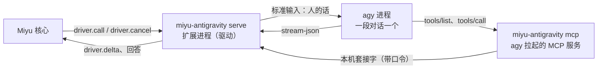

## antigravity：把 Antigravity CLI 当模型供应商

Miyu 的一个扩展包（包编号 `antigravity`，仓库和程序叫 `miyu-antigravity`）。它登记一个模型驱动 `antigravity/antigravity`：
主人在供应商配置里写上它，这家供应商的每一次调用就交给本机的 `agy`，用的是主人在 agy 里已有的登录和订阅额度。

状态：已定（2026-11-14，agy-cli 会话写；第十一节四条项目主人当天定了）。照核心设计 `66-扩展提供模型驱动.md`、
`71-供应商侧工具.md` 做。

### 一、定了的方向（项目主人 2026-11-14，记在核心设计 71 第一节）

- **agy 只当模型。** 工具循环在 Miyu：Miyu 的工具经本包自己的 MCP 服务挂给 agy，agy 一调，本包就把这次调用交回核心去
  执行，权限、沙盒、工具卡片和别的模型一样；结果再经 MCP 回给 agy。
- agy 跑命令、读写文件的原生工具全关。只读、不碰本机的原生工具留在 agy 里跑，报成供应商侧工具（设计 71）。
- 旧版 Miyu（0.7）的做法是把整个工具循环交给 agy，不照搬；它的代码只当「agy 这个 CLI 怎么用」的参考。

### 二、agy 是什么样的（1.4.0，2026-11-14 在隔离的家目录里实测；带「旧」的是旧版代码记下的、这次没重测）

| 事 | 实测 |
|---|---|
| 怎么调 | `agy --print= --input-format stream-json --output-format stream-json --dangerously-skip-permissions --model <slug> --agent <名> --add-dir <目录> --print-timeout <N>s [--conversation <id>]`；提示词从标准输入给，一行一轮：`{"event":"user","message":{"content":[{"type":"text","text":"…"}]}}` |
| 输出 | 一行一个事件，三种：`init`（带 `conversation_id`、`init.agent`）、`step_update`、`result` |
| 正文 | `step_type: "agent_response"`，`text_delta` 是增量；一步先几条 `ACTIVE`、最后一条 `DONE`，`DONE` 带这一次模型调用的 `usage {input_tokens, output_tokens, thinking_tokens, cache_read_tokens}`（`input_tokens` 是没命中缓存的那部分） |
| 思考 | 流里没有思考的字，只有 `thinking_tokens` |
| 工具步骤 | `step_type: "tool"`，同一个 `step_index` 两条：`ACTIVE`（`tool_info.parameters` 一次给全）、`DONE` 或 `ERROR`。MCP 工具的 `DONE` 带 `tool_info.output`；**原生的 `search_web`、`read_url_content` 的 `DONE` 不带结果** |
| 原生工具的结果在哪 | agy 自己的转录 `~/.gemini/antigravity-cli/brain/<会话>/.system_generated/logs/transcript_full.jsonl`：同一个 `step_index` 的一行，`content` 是结果的字 |
| `search_web` | 参数 `{"query"}`；结果是一段带引用编号的搜索摘要 |
| `read_url_content` | 参数 `{"Url"}`；结果只有标题和一句「全文存在 `…/steps/<n>/content.md`，可以用 `view_file` 读」——**不开 `view_file` 它就读不到正文** |
| 系统提示词 | 没有参数能给。写成自定义代理 `~/.gemini/config/agents/<名>/agent.md`（frontmatter 的 `tools:` 是原生工具的白名单，正文整体替换 agy 的默认指令），`--agent <名>` 选它。白名单只写这两件时，让它列目录它答没有工具（实测）。`init.tools` 列的是整张注册表（60 件），不是开着的 |
| agy 自己加的字 | 人的话外面包 `<USER_REQUEST>`，后面跟当前时间等几段；一轮空对话约 2.7k token 的底 |
| MCP | 只能全局注册在 `~/.gemini/config/mcp_config.json`；agy 起来时就拉起 MCP 服务，**把自己的环境变量原样传给它**（实测）。条目里 `tools: {<名>: {"eager": true}}` 的，在 agy 那边叫 `mcp_<服务名>_<工具名>`，可以直接调 |
| MCP 调用的先后 | 模型一步里要了两个调用，agy **一个做完再发下一个**（实测）：同一时刻至多一个调用挂着 |
| MCP 等多久 | 条目里不写超时的，一个调用等 **3 分钟**就判失败（`MCP tool call to server "…" timed out after 3m0s`，模型自己接着说）；写了 `"timeoutSeconds": 3600` 的，实测挂 25 分钟照样等到结果。等的时候流里一条都不出 |
| 续传 | `--conversation <id>`；目标没了**不报错、悄悄新开**，只能核对 `init` 里的编号（旧） |
| 进程复用 | 标准输入不关，再写一行就是下一轮，复用时不再发 `init`；冷启动 5～9 秒（旧） |
| 输入上限 | 只收文字；一条超过 192,000 字节的从尾部悄悄截断、照样报成功（旧） |
| 坏会话 | 出过错的会话带着错误状态，之后每轮原样回吐（旧）；被 Google 内容策略拦下的，拦截文案当正文流出来、`result` 报成功（旧） |
| 模型 | `agy models`：一行 `slug<TAB>显示名`，档位在 slug 里（`gemini-3.8-flash-low`、`claude-opus-5-5-high` 这样） |
| 登录 | `~/.gemini/antigravity-cli/antigravity-oauth-token`；`HOME` 换成别的目录、里面放这份文件就能用（多账号就是这么分的） |

**2026-11-16 真机补测（AG-3 做完后，隔离的家目录，flash 档）：**

- 代理文件 `tools: []` 时 MCP 的 `eager` 工具照样能调：白名单只管 agy 的原生工具，**管不到 MCP 工具**。
- 流里 MCP 工具步的名字是 `mcp_miyu_<工具名>`；`tools/call` 和流里的 `ACTIVE` 前后脚到（实测 MCP 那边先到）。
- 一件、连着两件工具调用、带结果以后接着说、下一轮复用同一个进程、人打断工具后重放，都走通；等工具结果时流是静的。
- 扩展退出时 agy 和它拉起的 MCP 服务一起没了，会话文件、套接字文件都删了。关标准输入以后 agy 会再写一条
  `result`（`ERROR`，`stream input cancelled`），没人听，只进日志。
- agy 自己每次请求约带 3,400 token 的固定开销（一句话的提问 `input_tokens` 是 3,453）。

### 三、形状

- **扩展进程**（核心拉起）：接 `driver.call`，管着 agy 进程、对话的对应、给 MCP 服务用的本机套接字。
- **MCP 服务**（agy 拉起，同一个程序的 `mcp` 子命令）：很薄，只把 `tools/list`、`tools/call` 转给扩展进程。它靠 agy 传下来的
  环境变量（套接字地址、一次性的口令）认出自己属于哪个 agy 进程。没有这两个变量的（主人自己开的 agy）回一张空的工具表。
- **agy 进程**：一段对话一个，活着的时候连着收好几轮。

### 四、一次 `driver.call` 怎么走

1. **认是哪段对话。** `driver.call` 里没有会话编号。扩展自己记着每个活着的 agy 进程「上一次请求每条消息的指纹」（`fingerprint.messages`）
   和那一次系统提示词、工具面、模型的指纹。这一次的消息指纹以它为前缀、别的指纹都一样的，就是那段对话的下一步。
2. **是哪种下一步**，看前缀后面多出来的消息：
   - 一条 assistant（我们上一次交的）加一条或几条 user：新的一轮。把 user 的字写进 agy 的标准输入。
   - 一条 assistant（里面是我们交的工具调用）加它的 tool 结果，而且那个 agy 进程正挂着这一个 MCP 调用：把结果经 MCP 回给 agy，
     接着读流。
   - 别的（对不上、多了少了、挂着的调用对不上号）：这段 agy 对话作废（杀进程），照第五节重放。工具结果后面核心还接了
     别的消息的（人在她干活时排进来的话、切了权限的告知）也算这一种：这一版不往挂着的调用里塞话，重放一次。
   - 挂着的那段，认的时候比闲着的多看三样，哪一样不对都作废、重放：assistant 那条里恰好一个工具调用、它的私有数据
     是我们交的那个编号；tool 那条的 `call_id` 就是这个工具调用的；挂着期间 agy 的流里没来过任何一行（来了说明它那边
     已经不等了，见第十节）。
   - 一次请求的消息以某段**挂着的**对话记着的那串开头（含一模一样）、却不是上面那种接法的（人打断了工具又说了话、
     核心把同一次请求重发了一遍）：那段挂着的当场收掉，不等它到点。
3. **没有对得上的**：新开一段 agy 对话，把整份历史转写成一条文字发过去（第五节）。
4. **读流，交增量**（核心设计 66 第五节的写法）：
   - `agent_response` 的 `text_delta` → 一块正文。
   - 原生工具步骤（`search_web`）→ 一块供应商侧工具：`ACTIVE` 开块、交参数；`DONE` 以后从转录里读结果交 `outcome`、收块。
   - MCP 工具步骤：内容以 MCP 服务收到的 `tools/call` 为准（名字、`arguments` 原文），先后以流为准：等流里这件工具的
     `ACTIVE` 步也到了再交（它前面的正文都已经读完），交一块工具调用（私有数据里记这一次 MCP 调用的编号）、收块，
     **这一次 `driver.call` 到此结束**（回用量）。agy 那一头挂着等。两边只到了一边的：等 10 秒，流那边没到照交，MCP 那边
     没到（MCP 服务没连上扩展）这段对话作废、这一次出错。
   - `result`：这一轮说完了，回用量；`status` 不是成功的照第八节归类。
5. **用量**：这一次 `driver.call` 期间每个 `agent_response DONE` 的 `usage` 加起来：`uncached = input_tokens`、
   `cache_read = cache_read_tokens`、`output = output_tokens`、`reasoning = thinking_tokens`。`result.usage` 是整段会话累计的，不用。

模型一步里要了几个工具调用时，agy 一个一个发：Miyu 这边看到的是连着几条回复、每条一个工具调用。

### 五、新开对话时的重放

- 触发：没有对得上的 agy 对话（第一次、核心重启、扩展重启、压缩、撤销、分叉、换过模型又换回来、上一段作废了）。
- 做法（照旧版 `cli_relay/payload.rs` 的格式）：一段说明加 `<conversation-history>`，里面照先后写 `User:`、`Assistant:`、
  `[called tool NAME with ARGS]`、`[tool result]`；最后一轮的 user 消息单独成块跟在后面。供应商侧工具照核心给的那段
  `<hosted-tool>` 的字。
- 一条输入不超过 172,800 字节（agy 的上限打九折）：超了从最老的回合丢起，写一句省略；这一轮的消息不砍。
- 请求的最后一条是 tool 结果、却没有挂着的调用（例如核心重启以后接着跑工具循环）：历史照样转写，末尾补一句让它接着做。

### 六、工具面

- 每个 agy 进程的工具表是它那段对话的 `request.tools`：名字、说明、参数格式。MCP 服务答 `tools/list` 时照 Gemini 认的写法
  整形（只留它认的键、`type` 不许是数组、空的 `enum`、空 `properties` 的对象要改写；一件写坏了会让整轮的工具全被拒）。
- 直接调要逐个登记：扩展把见过的工具名并进 `mcp_config.json` 里本包那一条的 `tools`（`eager`）。名单变了要等下一个新起的
  agy 进程才生效；工具面和记着的不一样的，那段对话照第四节第 1 条本来就对不上，会新开。
- 全局注册的条目叫 `miyu`（agy 那边的工具名是 `mcp_miyu_<名>`）；旧版 Miyu 留下的同名条目由本包接管、改写。
- 核心交回的工具结果是几块：文字接起来回给 agy；图片、文件这一版换成一句占位（MCP 能带图，agy 收不收以后再测）。

### 七、供应商侧工具

- 这一版只开 `search_web`：清单 `hosted = ["search_web"]`，代理文件的白名单也只写它。结果从转录读，去掉开头两行时间。
- `read_url_content` 不开（第十一节第 1 条）：它只交回标题和一个本机文件路径，要 `view_file` 才读得到正文，而 `view_file` 是能读
  本机任意文件的原生工具，必须关着。读网页走 Miyu 自己的 `web_fetch`（经 MCP，核心执行）。
- agy 自己记着对话，驱动不用把这种块带回去；交的时候不带私有数据（核心设计 71 第三节第 5 条）。
- **别的工具步一律照实交成供应商侧工具**（名字原样）：流里出现的工具步，不是 `mcp_miyu_` 开头的，都是 agy 那边自己跑了的
  ——`search_web`，也可能是主人在 agy 里自己配的别的 MCP 服务、插件带的工具（`mcp_config.json` 是全局的，白名单管不到，
  本包关不掉）。它们不过 Miyu 的权限和确认，本包做得到的是不瞒着：照实显示，没写进清单 `hosted` 的核心会记一行警告。
  不想让模型在 Miyu 里用到的，主人在 agy 那边关（`agy mcp disable <名>`）。README 写明。
- 结果从哪来：这一步 `DONE` 时流里带了 `output` 的用它，没带的从转录读（`search_web`）；读不到的不交结果、照样收块。
  `ERROR` 的交 `failed`，字是流里的原话。自己先截到 64 KiB。

### 八、出错、打断、清理

| 情况 | 怎么认 | 归成 |
|---|---|---|
| 没登录 | `result.error` 里有 `not logged in`、`unauthenticated` 这类字（标准错误里那行每次都有，不算数） | `auth` |
| 额度、限流 | `quota`、`rate limit`、`resource_exhausted`、`usage limit`、`credits` 这类字 | `quota` / `rate_limited`；这段对话作废 |
| 内容策略拦截 | 正文就是那段固定的拦截文案 | `content_policy`；不交那段字；这段对话作废 |
| 续传丢了 | `init` 的编号不是要的那个 | 当场杀掉，照第五节重放一次 |
| 代理没挂上 | `init.agent` 不是要的那个 | `unclassified`，原话写明 |
| 别的出错、没有 `result` 就退出了 | — | 还没交增量的 `retryable`，交过的 `unclassified`；这段对话作废 |

- `driver.cancel`、核心不要了：对 agy 的进程组先 `SIGTERM`、5 秒后 `SIGKILL`，这段对话作废。
- 挂着的 MCP 调用等不来结果（人打断了、换了供应商）：超过第十节的上限就收掉那个进程。表里超过上限时，挂着的和闲着的
  一样照「最久没用的先挤」收。
- 清理：作废的、闲置到点的 agy 进程收掉；它在 agy 那边的会话文件（`conversations/<id>.db*`、`brain/<id>/`）一起删；代理目录
  一小时没用过的删。扩展退出时把自己起的 agy 全收掉。

### 九、系统提示词、模型、配置

- 代理文件名 `miyu-<内容哈希>`，正文是 `request.system`，每次起 agy 前写好；起来以后核对 `init.agent`。
- `driver.models` 照 `agy models` 的输出交；窗口、最大输出 agy 不报，留给主人手写或目录。`params.effort` 不用：档位在模型名里。
- 清单：`cache = "best_effort"`、`key = "none"`、`images = false`（agy 只收文字，图由核心转述）。
- 配置项：`antigravity.binary`（agy 在哪，默认找 `PATH`）、`antigravity.keep_seconds`（agy 进程闲置多久收，默认 600）、
  `antigravity.tool_wait_seconds`（第十节）。用哪个账号不归本包管：agy 用它自己的登录，扩展照自己的 `HOME` 跑它。
- 供应商和模型条目主人手写（扩展改不了配置）：`driver = "antigravity/antigravity"`，价格写 0。README 给能抄的例子。

### 十、时限

- **agy 等 MCP 调用**：本包那一条 MCP 写 `timeoutSeconds`，值是配置项 `antigravity.tool_wait_seconds`（默认 3600）加 60。
  核心执行工具、等人点确认的时间都算在里面。扩展自己也照这个数等：到点还没等来带结果的下一次 `driver.call`，就收掉那个
  agy 进程，这段对话作废。agy 先判了超时的（流里那一步是 `ERROR`、原话带 `timed out after`），同样作废：它那边已经当
  工具失败接着说了，和 Miyu 这边对不上。认法不看原话：agy 等 MCP 调用时流是静的，**挂着期间流里来了任何一行**就算它
  不等了（MCP 服务那条连接这时还开着，光靠回话写不写得进去认不出来）。
- **核心等增量**：一次 `driver.call` 里 180 秒没有一条增量就判超时（思考强度高的放大），总共不超过它的 10 倍。agy 不流
  思考的字：从写进标准输入到第一段字，实测几秒到十几秒（flash 档）；慢的档位、搜索慢的时候会不会超，AG-5 拿真 agy 量。
  超了的话这一版先照核心的规矩当可重试，量出来真碰得到再找核心商量保活的写法。
- **整轮**：`--print-timeout` 给一天，活不活靠上面两条判。

### 十一、项目主人定了的（2026-11-14）

1. `read_url_content` 不开，只留 `search_web`（第七节）。
2. 往主人真的 agy 配置里写两样：`~/.gemini/config/agents/miyu-*/`（系统提示词）和 `mcp_config.json` 里的 `miyu` 一条。主人
   自己开 agy 时这条 MCP 给的是空的工具表。
3. 仓库 `miyu-agent/miyu-antigravity`，公开，先当社区包收进软件源。
4. 多账号不是本包的事：不做选账号、不做轮换，就照 agy 命令行现成的用法调它。

### 十二、不做的

- 图片进 agy、思考的字、agy 的原生工具（除了 `search_web`）、agy 自己的子代理和后台任务。
- 多账号：选账号、几个账号轮着用、额度用完自动换（第十一节第 4 条）。
- Windows：第一版只打 Linux、macOS 的包（进程组、本机套接字的写法先照 Unix）。

### 十三、施工

| 步 | 做什么 |
|---|---|
| AG-1 | 骨架：仓库、清单、握手、`driver.models`；agy 的流解析（照实测录下的样本）；一问一答的 `driver.call`（没有工具、每次新开对话重放） |
| AG-2 | 对话的对应和进程复用：指纹前缀、续上、作废、清理 |
| AG-3 | MCP 服务和工具交回：套接字、`tools/list` 整形、`tools/call` 挂起、结果回给 agy；全局注册 |
| AG-4 | `search_web` 报成供应商侧工具（读转录）；出错归类；内容策略、坏会话 |
| AG-5 | 真 agy 走一遍的验收脚本、README、发版流程 |

### 决定

| 已定 | 没选 | 重开条件 |
|---|---|---|
| agy 只当模型，工具交回核心 | 工具循环交给 agy（旧版） | 无 |
| 对话靠消息指纹的前缀认 | 等核心在 `driver.call` 里给会话编号 | 核心给了会话编号 |
| MCP 服务是 agy 拉起的薄壳，经本机套接字找扩展 | 扩展自己开 HTTP 的 MCP 服务（全局只能登记一个地址，认不出是哪个 agy） | agy 能按进程指定 MCP 配置 |
